# Madrasa Pro — School & Madrasa Management System

**Version 1.0.8** · Python 3.11+ (3.12 recommended) · FastAPI · SQLAlchemy 2 · SQLite · Jinja2 · Alpine.js 3.17.5 (bundled) · Tailwind CSS 3.4.19 (prebuilt) · cryptography (Fernet, for stored API secrets)

**Try it on your computer:**
1. Unzip the archive and open the **`Madrasa Admin Project`** folder (not the outer `Madrasa_Admin_1.0.8` folder alone).
2. Double-click **`start.bat`** on Windows (or run `./start.sh` on Linux / macOS). No extra environment variables are required.
3. Open **http://localhost:8000**, then **Live Demo** or **/login**. The login page shows a Demo sign-in box with Administrator, Teacher and Student, each with the username and password in plain text. Click a box to fill the form, or use “Sign in with this account”.

**For a real school set `DEMO_LOGINS=false`** (in `.env` or the host environment). That hides the boxes and disables the three demo accounts. It does not wipe your data.

`start-demo.bat` / `./start-demo.sh` is only for the public sample school (`DEMO_MODE=true`): it wipes and re-seeds the database on every start. Do not use that on real data.


**Live demo:** https://madrasa-ms.onrender.com/ — the landing page; click **Live Demo** and use a Demo sign-in
card, or **Take the tour**. Developer: Syed Abue Tayeb Al-Zeyed

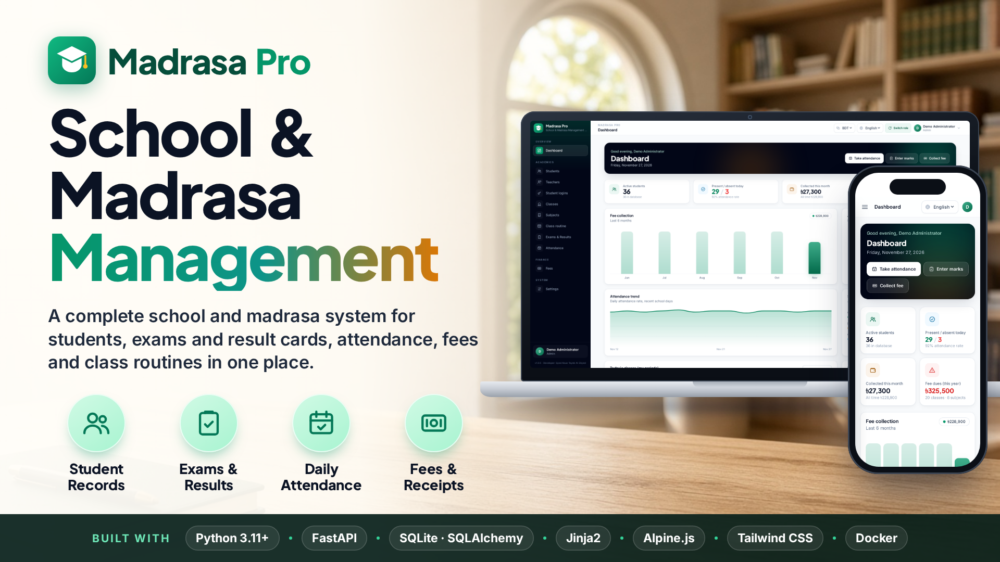

## Demo access (admin / teacher / student)

The public demo runs with `DEMO_MODE=true` + `SEED_DEMO_DATA=true` (see `app/demo.py`, `docs/DATASHEET.md`).
`/` is the public landing page; its **Live Demo** button opens `/login`, which shows a **Demo sign-in** box under
the form (username, password, and **Sign in with this account**). Clicking a card fills the form. A one-click
button per role is also there. **Take the tour** opens `/tour?autostart=1`.

| Role | Demo account | Password | How to enter | What you can try |
|---|---|---|---|---|
| Admin | `demo.admin` | `Admin@2026` | Demo sign-in card or one-click on `/login` | everything: students, teachers, logins, routine, exams, attendance, fees, all settings (branding, currencies, languages, email, payment gateways, SMS) |
| Teacher | `demo.karim` (Abdul Karim, Math + Science in the Grade classes) | `Teacher@2026` | Demo sign-in card or one-click | only his own classes: attendance, marks for his subjects, routine |
| Student | `demo.student` (first sample student, Ahmed Rahman) | `Student@2026` | Demo sign-in card or one-click | own profile, published results, attendance, fees, class routine |

- **Switch role** (top bar / demo banner) goes back to the demo buttons at any time.
- **The demo database is wiped and re-seeded on every restart** (`app/demo.py reset_database_files` + `app/seed.py`):
  20 classes with sections, subjects, periods and a full weekly **timetable** (4 sample teachers), 36 students,
  **attendance** for the last 4 weeks, a published *1st Term* exam with **marks/results**, **fee plans** for every
  class and six months of **fee payments** with receipts, so every chart and list has data. Tested in
  `tests/test_demo_v104.py` and `tests/test_v105.py`.
- Demo accounts receive real hashed passwords only when demo mode starts. On a normal install those passwords
  are never stored, and `POST /demo/login` answers 404. Visitors are never logged in automatically.
- **Secrets in the demo:** every setting can be changed and saved, but passwords and API keys typed into the
  Email / Payment gateways / SMS settings are **never stored**, test emails are not sent, and saved secrets are
  never sent back to the browser (only "set / not set").
- **Safety:** demo mode is OFF by default. The app refuses to start with `DEMO_MODE=true` together with
  `COOKIE_SECURE=true`, `SEED_DEMO_DATA=false` or an `ADMIN_USERNAME`/`ADMIN_PASSWORD` bootstrap, and it refuses to
  wipe a database that holds a real (non-demo) administrator. A loud warning is logged when demo mode starts.
  The 1.0.4 name `DEMO_AUTO_LOGIN=true` still works and means the same.
- **A normal install has no demo accounts and no default password:** the first start opens `/setup`, where you
  create your own administrator; teachers and students get logins from the administrator.

## Audit evidence (Vibe96 runs #3278 / #3282)

| Topic | Where to look |
|---|---|
| Role guard on every route, DELETE checks, teacher marks scope | `docs/ROUTES.md` (top table), docstring of every `app/api/*.py` module, `tests/test_guards_v104.py` |
| Parameterised queries, scoped deletes (fees, attendance, exams) | `docs/SECURITY-EVIDENCE.md` (grep output + tests) |
| pip-audit / npm audit output, lockfile check | `docs/DEPENDENCY-AUDIT.md`, `requirements.lock`, `package-lock.json` |
| Schema: FK indexes + ON DELETE rules, PRAGMAs | top of `database/schema.sql`, `app/models.py`, numbered migrations in `app/database.py` |
| Demo accounts and demo data | this section, `docs/DATASHEET.md`, `app/demo.py` |
| Runtime secrets | `data/` ships only `.gitkeep` + `README.txt`; `data/.secret_key` is generated at runtime and ignored |

A complete, ready-to-run web app to manage a madrasa, private school, hifz academy or tuition centre:
students, subjects, exams and result cards (GPA), a weekly **class routine** with teacher-subject assignments,
daily attendance, monthly fees with printed receipts, staff accounts and a student portal. It runs on one
Windows PC in the office, on a Linux VPS behind nginx with HTTPS, or in Docker, and is used from any browser:
every page is **mobile responsive** (phones from 360 px wide, tablets and desktops).

**New in 1.0.8:** the Demo sign-in box is on `/login` by default (`DEMO_LOGINS`, default true) — you do not need `DEMO_MODE` or `start-demo.bat` to see it. Set `DEMO_LOGINS=false` for a real school.

**New in 1.0.7:** the landing page stays at `/` even before setup; `start-demo.bat` / `start-demo.sh` turn on the public demo; the Demo sign-in box matches the usual pink dashed card with a red “Sign in with this account” link; the product tour chrome matches a video-style walkthrough more closely.

**New in 1.0.6:** a redesigned **landing page** (sticky nav, hero, stats, features, roles, screenshots, how it
works, FAQ, Live Demo and Take the tour), **demo sign-in cards** with real demo passwords under the login form, and
a self-hosted **product tour** at `/tour?autostart=1`. The rest of the app is the 1.0.5 release.

**New in 1.0.5:** a public **landing page** with a Live Demo button, **one-click demo logins** for every role, a
complete **admin settings** area (branding with logo, name and colours; currencies; English / Bangla / Arabic with
right-to-left layout and a translation editor; SMTP email with a test button; Stripe, PayPal, SSLCommerz and bKash
payment gateways; SMS gateway) with **encrypted secrets**, and a **full premium redesign** (new design system,
dashboard charts, loaders, toasts, empty states, desktop / tablet / mobile).

| Role | Logs in to | Sees |
|---|---|---|
| **Admin** | Dashboard | Everything: students, teachers, student logins, routine, subjects, exams, attendance, fees, classes, settings |
| **Teacher** | Dashboard (own classes today) | My students, My routine, My subjects, Marks & results (marks only for assigned subjects), Attendance — **only the classes they teach**. No fees, settings, user management or other teachers. |
| **Student** | Own profile | My profile, My results, My attendance, My fees, Class routine — **only their own record** |

## Who it is for
- **Madrasas and hifz academies** (Hifz Level 1-10 classes, Quran/Tajweed/Arabic subjects are created for you).
- **Private schools and kindergartens** (Grade 1-10, sections A/B, Bangladesh GPA 5.00 or a 4.00 scale).
- **Coaching / tuition centres** that need fees, attendance and printable results.
- **Developers and agencies** who want clean FastAPI source code to rebrand and install for a client.

## Screenshots

All screenshots are real (demo data, 1920 x 1080). A square image for listings: `docs/screenshots/landing-square-1080.png`.

| | |
|---|---|
| 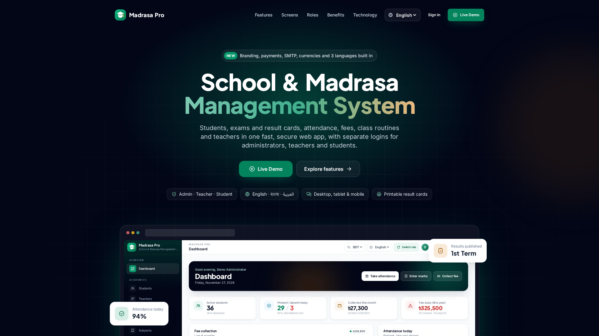 **Public landing page with the Live Demo button** | 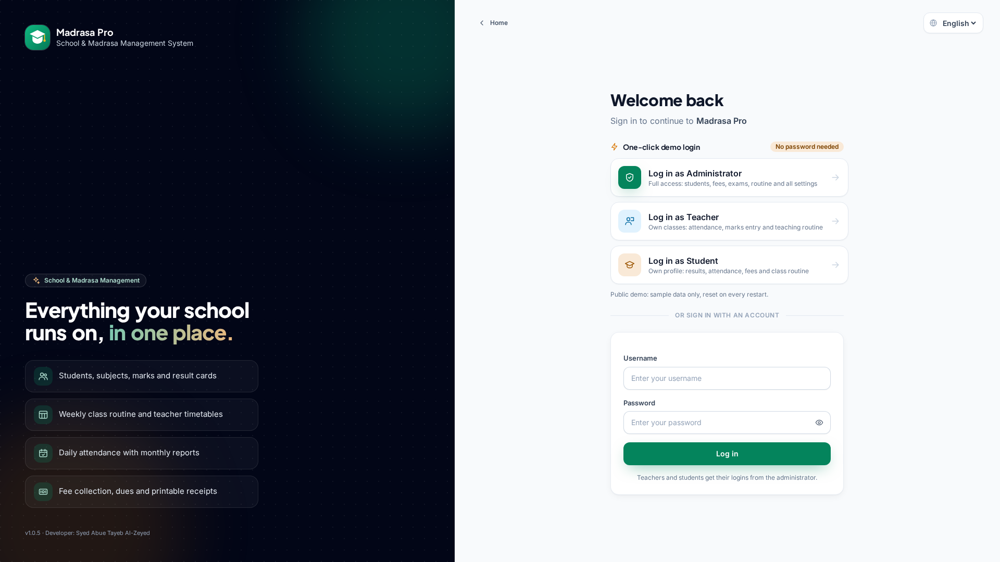 **Login with one-click demo buttons for every role** |
| 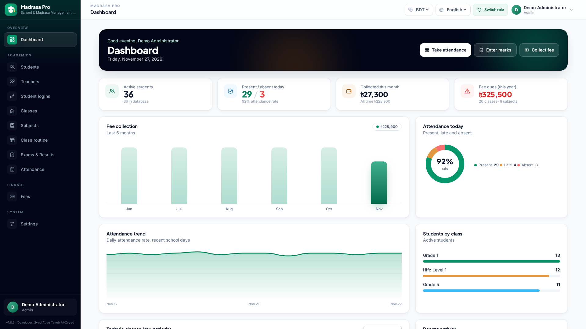 **Dashboard: stat cards, fee chart, attendance donut and trend** | 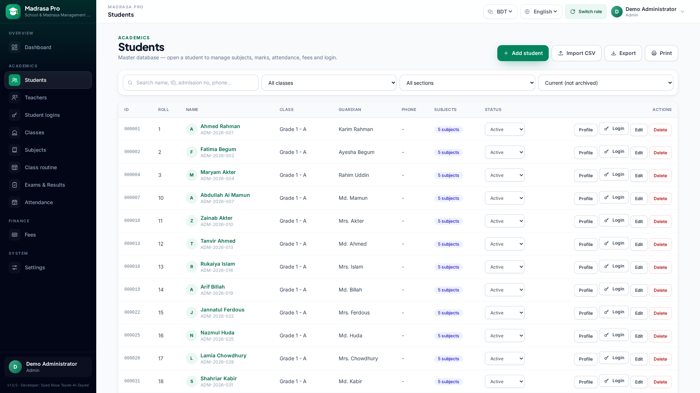 **Students: the central database** |
| 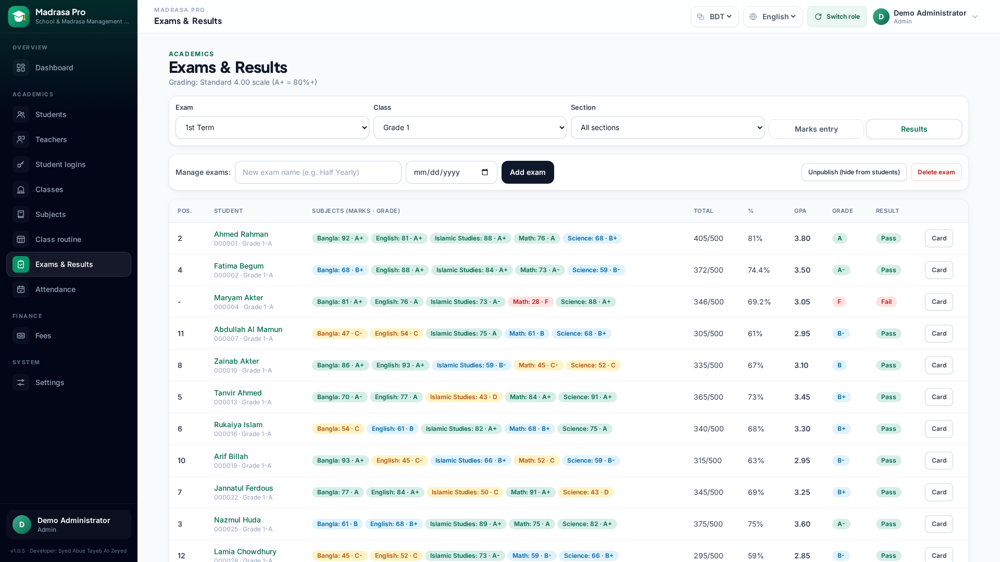 **Exams & results with GPA and merit position** | 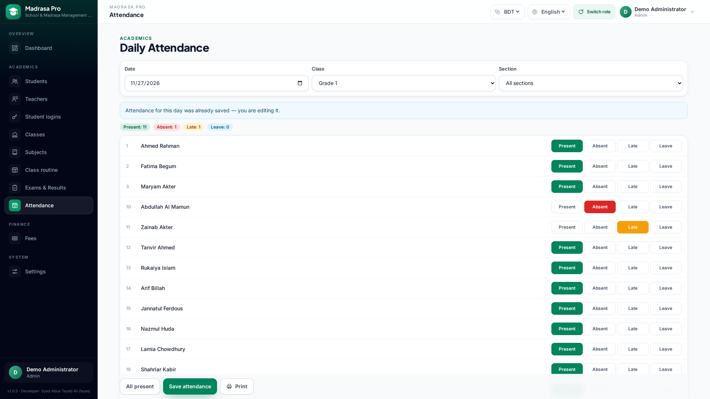 **Daily attendance** |
| 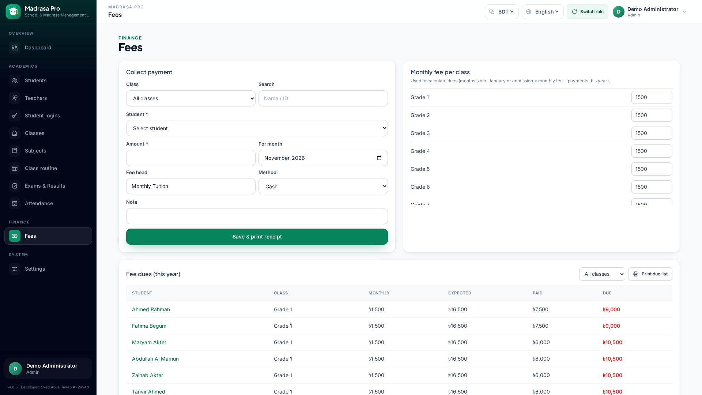 **Fees, dues and receipts** | 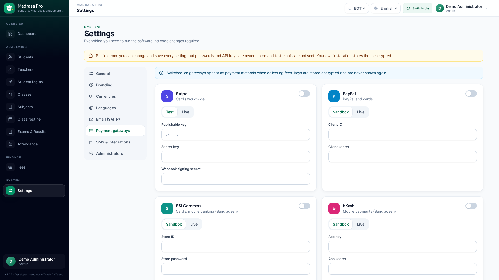 **Settings: Stripe, PayPal, SSLCommerz, bKash** |
| 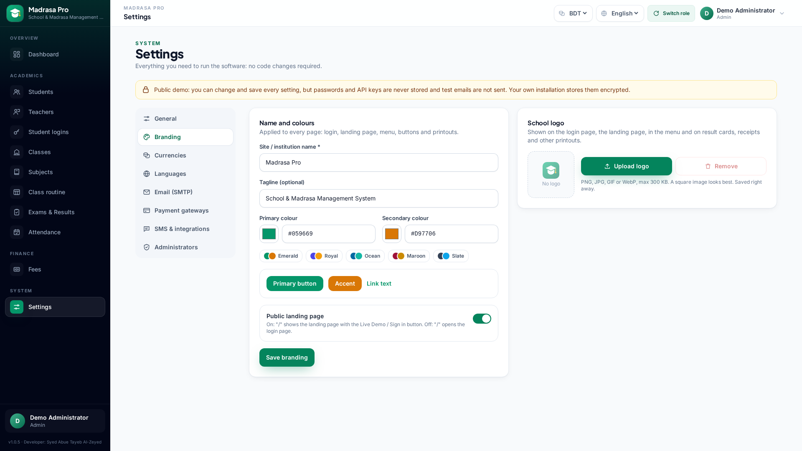 **Settings: branding (name, logo, colours, landing page)** | 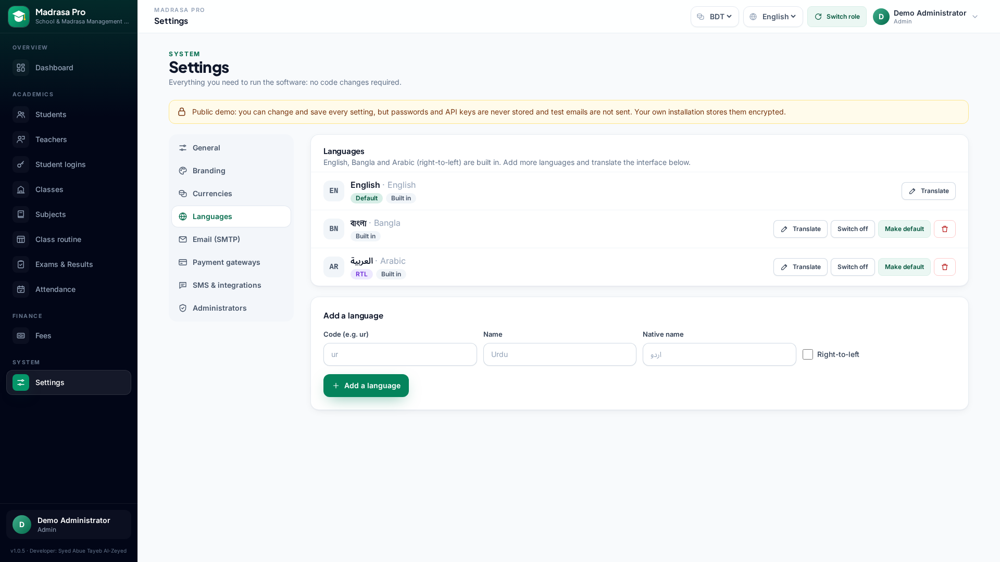 **Settings: languages and translations** |
| 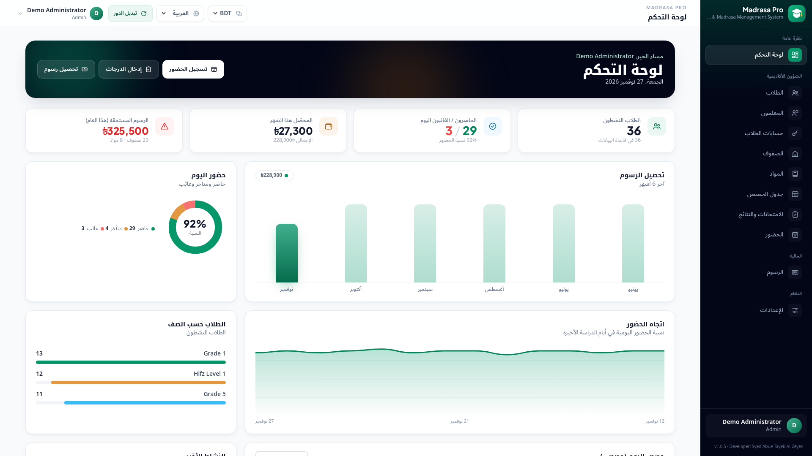 **Arabic, right-to-left** | 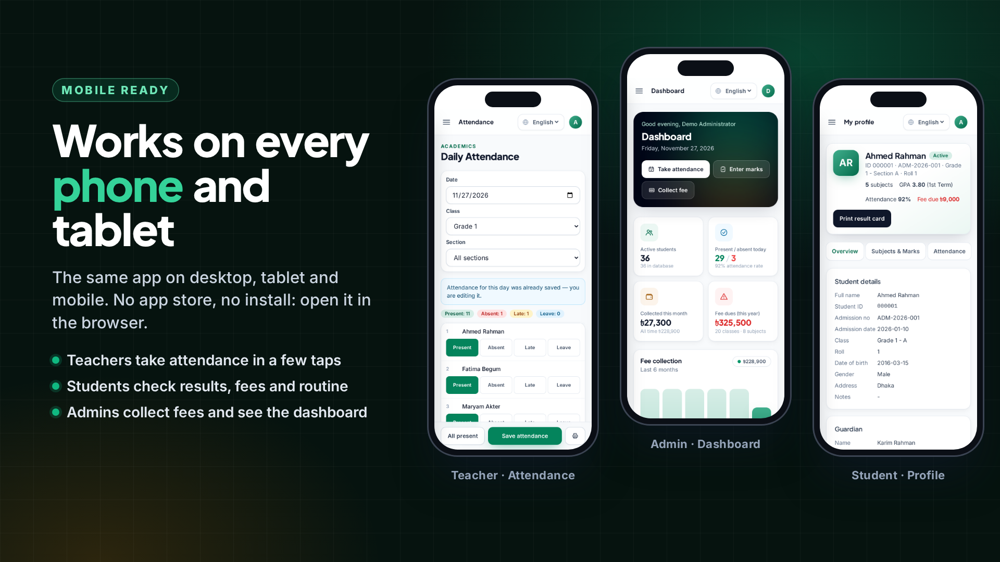 **Phone and tablet layouts** |

## Features

### Students (the central record)
- Search by name, student ID, admission no or phone; filter by class, section and status.
- Add, edit, change status (Active, Inactive, Transferred, Graduated, Archived) or delete.
- **CSV import** (sample file included, Excel "CSV UTF-8" works) and **CSV export**; printable student list.
- **Student profile hub**: details, subjects and marks, attendance, fees and portal login on one page.

### Subjects, exams and results
- Subject master: code, full marks, pass marks, credits, active.
- Default subjects per class, applied automatically to new students; add or remove subjects per student.
- Exams can be kept as drafts or **published** to students.
- **Marks entry**: a grid (class x subject) or, on phones, one subject at a time; out-of-range marks are highlighted and blocked.
- Teachers enter marks only for the subjects the admin assigned to them (other subjects are shown read-only).
- Results: total, %, grade, grade point, **credit-weighted GPA**, Pass/Fail/Incomplete, **merit position**.
- Grading scales: **Bangladesh GPA 5.00** (pass 33%, any failed subject gives GPA 0.00) or **Standard 4.00**.
- **Printable result cards**: one student or **Print all** for a class/section.

### Teachers and logins
- **Teachers page** (admin): list with phone, login status, last login, assigned subjects/classes and periods per
  week; add a teacher (full name, username, optional phone, initial password typed or generated); edit, reset
  password, enable/disable the login; jump straight to *Assign subjects*.
- New and reset teacher/student passwords are **temporary**: the person must choose their own at first login.
- **Student logins page** (admin): login status of every student; create, reset, disable or enable a login; or
  **create logins for a whole class/section at once** (username = 6-digit student ID). The temporary passwords
  are shown **once** as printable login slips or a CSV download; only password hashes are stored.

### Class routine and teachers
- **Teacher assignments**: the admin assigns a teacher to each subject of a class (for all sections or one section).
- **Periods**: start/end time, name and break flag (demo: six periods and a tiffin break). Working days are chosen
  in Settings (default Saturday to Thursday).
- **Weekly routine grid** per class section (days x periods): tap a period to set subject, teacher and room. The
  assigned teacher is chosen automatically. The app blocks a teacher who is not assigned to the subject, a teacher
  booked in two classes at the same time, classes in breaks and on non-working days.
- **My routine** for every teacher, and **today's classes** on the teacher's dashboard. Students see their own
  class routine in the portal.
- **Printable routines** (A4 landscape) per class section and per teacher.

### Attendance
- Daily attendance per class and section: Present, Absent, Late, Leave, with large buttons on phones. Saved days
  reload for editing. Monthly report and printable sheet.

### Fees
- Monthly fee per class; dues calculated for the year.
- Payments with month, fee head and method (Cash, bKash, Nagad, Rocket, Bank, Card, plus Stripe / PayPal / SSLCommerz when switched on in Settings > Payment gateways). Amounts can be viewed in any active currency from the top bar.
- Numbered receipts (print or void) and a due list with a **printable due list** per class (guardian, phone, amount due).

### Administration
- Classes and sections (deleting is blocked while students are inside).
- **Your own app / institution name** and tagline (chosen at first-run setup, editable in Settings), address, office phone, currency and grading scale: your branding on the login page, menu, browser tab and every print.
- **School logo**: optional at first-run setup; a *School logo* card in Settings with preview, *Change* and *Remove* (PNG/JPG/GIF/WebP, max 300 KB). Shown on the login page, in the menu and on result cards, receipts and other printouts.
- Administrator accounts in Settings; teachers on the Teachers page; student logins on the Student logins page.

### Admin settings (1.0.5, stored in the database, no code changes)
- **Branding**: site / institution name, tagline, logo, **primary and secondary colour** (5 presets or any colour), applied to every page, the landing page and printouts; switch the public landing page on or off.
- **Currencies**: add, edit, switch off, delete; set the **default** (used for fees, receipts and reports; other rates are re-based); every active currency has a symbol, rate and decimals and can be picked in the top bar to view amounts converted.
- **Languages**: English, **Bangla** and **Arabic (right-to-left)** built in; add a language, switch languages from the top bar, the login page or the landing page, make one the default, and edit every interface text in the **translation editor**.
- **Email (SMTP)**: host, port, STARTTLS / SSL / none, username, password (encrypted, never shown again), From address and name, and a **Send test email** button.
- **Payment gateways**: **Stripe, PayPal, SSLCommerz, bKash**, each with an on/off switch, test (sandbox) / live mode and masked keys. Switched-on gateways appear as payment methods when collecting fees. (Online checkout is not built in: the keys are stored for your integration.)
- **SMS & integrations**: provider, HTTPS API URL, API key / secret (encrypted) and sender ID.
- Secrets are encrypted with Fernet (key derived from `SECRET_KEY`, `app/secret_store.py`) and the API only says whether they are set.

### Roles
| Role | Can use |
|---|---|
| **Admin** | Everything |
| **Teacher** | Only the classes/sections they teach (subject assignments or routine periods): students (view), marks for their assigned subjects, results, attendance, class routine, own routine, printing |
| **Student** | Own profile, own published results, own attendance, own fees and own class routine |

The rules are enforced on the server for every API route and page (a teacher asking for another class, or a
student asking for another student's record, gets `403`), not only hidden in the menu. See `docs/ROUTES.md`.

### Security
- Signed session cookies, CSRF protection on every change, role checks on every route (see `docs/ROUTES.md`).
- PBKDF2-SHA256 password hashing (600,000 iterations); no default passwords (the administrator account is created on a first-run setup page); temporary passwords from the admin must be changed at first login and are sent with `Cache-Control: no-store`; login throttling stored in the database (survives restarts, shared by workers).
- Security headers (CSP, no framing); all output escaped; validated image-only logo upload.
- Pinned, hash-checked dependencies (`requirements.lock`, all transitive packages); `pip-audit` and `npm audit`: no known vulnerabilities (`docs/DEPENDENCY-AUDIT.md`).

### Design (1.0.5 redesign)
- One design system (Tailwind, `frontend/input.css`): Inter + Plus Jakarta Sans (bundled, SIL OFL), a dark grouped
  sidebar, a top bar (currency, language, user menu), cards, buttons, switches, tabs, badges, toasts, a loading bar
  and skeletons, friendly empty states, clear focus rings and readable contrast.
- Dashboard with stat cards, a 6-month fee chart, today's attendance donut, an attendance trend line and students
  per class; colours follow Settings > Branding.
- Mobile first: slide-in menu, tables become cards or scroll inside their own box, 44 px touch targets and 16 px
  inputs (no zoom on iPhone). Printouts are unchanged.
- Everything is bundled (Tailwind CSS built into `static/app.css`, Alpine.js in `static/vendor/`): no CDN, works offline.

## Quick start (Windows)
1. Install Python 3.12 from python.org (tick **"Add python.exe to PATH"**).
2. Open the `Madrasa Admin Project` folder and double-click **`start.bat`** (first run installs everything).
3. Open **http://localhost:8000**. The first time, a setup page asks for the app / institution name (shown on the
   login page, menu, browser tab and printouts) and your own administrator username and password.
   There are no default passwords. Teachers and students get their logins from the administrator.

Full instructions for Windows, Linux, a VPS with nginx + HTTPS, and Docker are in **HowToSetup.md**.

## What is in the package
```
README.md            this file
HowToSetup.md        step-by-step installation (Windows, Linux, VPS + nginx + HTTPS, Docker)
CLAUDE.md            architecture, folder map, conventions, how to run the tests
CHANGELOG.md         version history (from 1.0.0)
LICENSE-NOTE.md      licence terms
.env.example         every setting with a comment
Dockerfile, docker-compose.yml, .dockerignore, render.yaml, GITHUB-RENDER.md
database/            schema.sql (creates the database) and seed.sql (demo data)
docs/                ROUTES.md (route/guard table), SECURITY-EVIDENCE.md, DEPENDENCY-AUDIT.md, DATASHEET.md,
                     api.md, erd.md, FIXES-v1.1.0.md, screenshots/ (cover + real screenshots, 1920 x 1080)
tests/               package checks (layout, schema = models, no secrets); pytest.ini, ruff.toml for them
Madrasa Admin Project/   the application (main.py, app/ incl. app/api/ routers, templates/, static/, tests/, tools/,
                         data/ (only .gitkeep + README.txt), start.bat/.ps1/.sh)
```

## Licence
Single-site licence: one purchase covers one school / madrasa (or one client project). You get the full
source code and may modify and rebrand it for that institution, but may not resell or redistribute the
source code. See **LICENSE-NOTE.md**.

Developer: Syed Abue Tayeb Al-Zeyed
