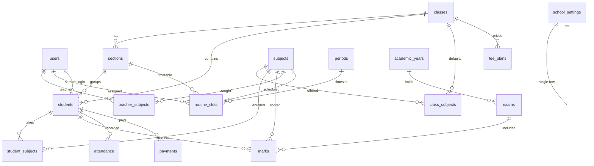

# Madrasa Pro — Entity relationship diagram

## Tables

| Table | Purpose |
|-------|---------|
| users | Admin, teacher and student accounts |
| school_settings | Institution name, logo, currency, working days |
| classes / sections | Academic structure |
| students | Student records |
| subjects / class_subjects / student_subjects | Curriculum |
| exams / marks | Results |
| attendance | Daily attendance |
| fee_plans / payments | Fees and receipts |
| periods / teacher_subjects / routine_slots | Timetable |
| academic_years | Year label for exams |
| login_attempts | 1.0.4: failed logins for the persistent login throttle (no FK) |
| app_settings | 1.0.5: SMTP / payment gateway / SMS settings, one row per field; secrets Fernet-encrypted (no FK) |
| currencies | 1.0.5: currencies with symbol, rate, decimals; one default (no FK) |
| languages / translations | 1.0.5: interface languages and the admin's own texts (translations.language_code -> languages.code) |
| schema_migrations | Numbered migrations applied (app/database.py) |

Every foreign key is indexed and declares ON DELETE (CASCADE / RESTRICT / SET NULL); the full list is at the top of
`database/schema.sql`. Payments, exams with marks and classes with students are protected by RESTRICT and by explicit
checks in the API.
